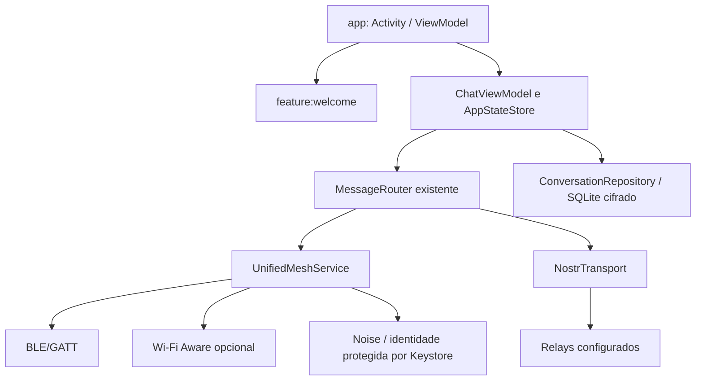

# Arquitetura do fork

## Base executável e fronteiras

A Fase 1 mantém `:app` como composition root e proprietário da pilha BitChat.
`:feature:welcome` é a primeira feature Gradle separada: Compose/Material 3,
somente apresentação, sem rede, identidade, contatos ou criptografia. O host
persiste a conclusão da apresentação e abre a implementação real existente.
`:wear` permanece no código como referência upstream, fora da primeira entrega
DaniChat para celular.

A tela nova não envia mensagens nem fabrica participantes. Ela encaminha para
o onboarding e as conversas reais herdadas. A apresentação não é uma barreira
de consentimento para rede: a inicialização de Application e dos serviços ainda
é a herdada. Consentimento granular e reorganização desse ciclo são parte da
Fase 2 e devem preceder a experiência de cadastro definitiva.

## Modularização incremental planejada

Os módulos abaixo são destino da arquitetura, **não módulos já implementados**.
Cada extração deve manter os testes de contrato e, quando afetar rádio ou
mensagens, passar pelo Mesh Lab físico.

| Módulo futuro | Responsabilidade e dependências |
| --- | --- |
| `:core:model` | Identidade pública canônica, ConversationId, MessageId e estados; sem telefone, UI ou Android |
| `:core:identity` | Noise/Nostr, vínculos assinados, verificação, exportação cifrada e Keystore; nunca fornecer chaves privadas à UI |
| `:core:database` | Room, migração do SQLite existente, histórico cifrado, outbox e deduplicação transacionais |
| `:core:routing` | Política pura, arbitragem e retries; depende de contratos, não de Activity |
| `:transport:mesh` | Adaptar `MeshService` existente, BLE/NAN, preservar wire format e bridge |
| `:transport:nostr` | Relays, codec padronizado, reconexão e publicação de envelopes cifrados |
| `:feature:conversations` | Lista, individual e grupos; ViewModel com StateFlow e repositórios |
| `:feature:profile` | Nome/foto/descrição, identidade, recuperação e telefone opcional |
| `:feature:connectivity` | Estado real de conexões/permissões, proximidade e ajustes |
| `:feature:privacy` | Consentimentos, bloqueio, verificação, exclusão e política de metadados |

Não adicionar DI, backend gerenciado ou dependências de criptografia por
conveniência. Primeiro reutilizar interfaces e bibliotecas já presentes.

## Identidade, histórico e entrega

Identidade de longo prazo é criptográfica. Peer IDs de sessão, chaves Nostr,
endereços BLE e telefone são referências distintas. O diretório canônico deve
ligar Noise/Nostr por prova autenticada; nomes ou números jamais provam posse
de chave. Vínculos novos exigem verificação antes de fundir históricos.

Na Fase 5, uma transação Room deverá criar mensagem e item da outbox antes do
envio. Um MessageId estável acompanha todas as tentativas; destinatário deduplica
por remetente autenticado + MessageId. Estados separados: pendente, entregue ao
transporte, confirmado pelo destinatário, lido e falhou. `WebSocket.send()` ou
`OK` de relay não comprovam entrega/leitura pelo contato.

Prioridade futura: sessão local autenticada direta → rota mesh autenticada →
Nostr com vínculo autorizado → fila durável. Um único árbitro reserva a tentativa
com lease persistente; nenhum fan-out simultâneo entre transportes. ACKs e
retentativas toleram queda de processo e ACK perdido. Entrega exatamente uma vez
não é prometida: deduplicação dá apresentação idempotente.

## Telefone opcional (Fase 4)

Usar parser consolidado para E.164 e backend próprio por TLS. O servidor emite
desafio curto com nonce, expiração, limite de tentativas e rate limiting; o
cliente prova posse da identidade ao concluir o OTP. Associar telefone somente
após confirmação real do provedor. Não incluir endpoint que aceite qualquer
código, SMS fictício, chave de provedor no APK ou número em evento Nostr.
Recuperação exige segredo/chave de recuperação ou dispositivo autorizado;
controle do número isoladamente não recupera a identidade criptográfica.

Descoberta de agenda fica desativada por padrão. Hash simples de telefone não
protege a agenda, pois o espaço é enumerável. Definir protocolo privado de
descoberta, retenção e consentimentos antes de integrar contatos do Android.

## Privacidade e serviços

Relays podem observar IP de origem (ou saída Tor), horários, tamanho, filtros,
chaves de destino e disponibilidade; podem registrar, censurar e reter envelopes.
Criptografia não apaga essas observações. Geohash/canais públicos podem revelar
localização e conteúdo. Não há garantia de anonimato, entrega ou apagamento remoto.

SMS/voz de verificação, números remetentes, hospedagem do verificador, relays,
armazenamento de mídia e banda podem gerar custos. Esta fase não provisiona
serviços pagos. BLE não exige operadora; internet e energia continuam necessárias
para os respectivos transportes. Mídia online exigirá blobs cifrados no cliente
com expiração e chaves apenas no envelope privado; não publicar arquivos abertos.

## Wi-Fi Direct

O uso atual é hotspot para compartilhar APK. Um transporte de mensagens exigiria
descoberta própria, estabelecimento de sockets, vínculo com Noise, revezamento de
Group Owner, tratamento de conflitos NAN/P2P, energia e testes entre fabricantes.
Avaliar em ADR e branch separados. Não anunciar suporte a chat Wi-Fi Direct.
